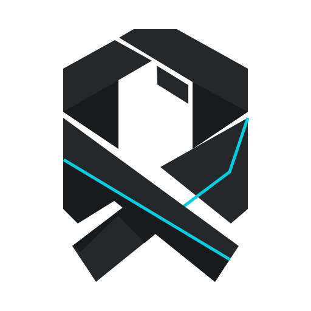

<!-- OPCODEX: product presentation. Copyright 2026 Opcodex contributors. SPDX-License-Identifier: Apache-2.0 -->

<p align="center"><picture><source media="(prefers-color-scheme: dark)" srcset="opcodex/branding/mark-dark-surface.svg"></picture></p>
<h1 align="center">Opcodex</h1>
<p align="center">A focused desktop workbench for reverse engineering.</p>
<p align="center"><a href="https://opcodex.xyz">Website</a> · <a href="https://github.com/Arjun-Walia/opcodex/releases">Releases</a> · <a href="https://github.com/Arjun-Walia/opcodex/issues">Issues</a> · <a href="CONTRIBUTING.md">Contribute</a></p>

Work with binaries, disassembly, decompiled code, symbols and graphs in one local workspace. Keep projects on your machine, extend the workbench with scripts, and choose a matched light or dark interface.

**Development preview: 1.0.0-alpha.2.** The desktop interface is being modernized. Public binary releases follow the [release checks](docs/releases/RELEASING.md); no final v1 release is available yet.

## Desktop

Windows supports a native **Opcodex.exe** with its own icon, bundled Java runtime, desktop shortcut and Start menu entry. Build and install it locally with:

```powershell
.\gradlew.bat installOpcodexDesktop
```

The installation uses a versioned folder under your user profile and keeps your projects and settings separate. See the [desktop guide](docs/DESKTOP.md).

Portable ZIPs use product-only names such as `opcodex_1.0.0-alpha.2_win_x86_64.zip`. Verify the accompanying SHA-256 file, extract into a fresh directory, then run `opcodexRun.bat` on Windows or `./opcodexRun` on Linux/macOS. Portable packages require a supported 64-bit JDK 21 or newer. GitHub's source archives are not installable apps.

## A clearer workbench

- **Opcodex Dark and Light:** black and neutral-light surfaces, readable syntax, quieter selection and visible focus.
- **Focused layout:** tabbed functions, symbols and types, balanced disassembly/pseudocode panes, visible resize grips and a console that opens in its own lower pane.
- **Quieter controls:** common actions stay visible; More keeps secondary commands within reach; a complete-toolbar option and every original menu remain available.
- **Consistent icons:** a live vector family covers all 878 declared icon IDs, including startup tools, graphs, debugger controls and data types.
- **Native file selection:** the Windows system picker handles ordinary files and folders.
- **Start with a project:** Create/Open actions on the welcome screen, with existing keyboard shortcuts.
- **Local workflows:** projects, analysis, decompilation, scripting and the existing extension ecosystem.

This is the first interface pass. Additional specialized tools and workflow details remain in development. See the [design system](docs/ui/DESIGN_SYSTEM.md), [icon catalog](docs/ui/ICON_CATALOG.md), [release notes](docs/releases/1.0.0-alpha.2.md) and [verification](docs/releases/VERIFICATION.md).

## Build

```bash
git clone https://github.com/Arjun-Walia/opcodex.git
cd opcodex
./gradlew -I gradle/support/fetchDependencies.gradle
./gradlew testOpcodex
./gradlew buildOpcodex
```

Use `.\gradlew.bat` in PowerShell. Native C/C++ build tools are required. Outputs, checksums and source manifests are written to `build/releases/`. Read the [build guide](docs/BUILDING.md) for prerequisites and compatibility details.

## License

Opcodex additions are Apache-2.0. Included components retain their original terms. [LICENSE](LICENSE), [NOTICE](NOTICE), [third-party notices](THIRD_PARTY_NOTICES.md) and [modifications](MODIFICATIONS.md) provide the required terms, attribution and change records.
