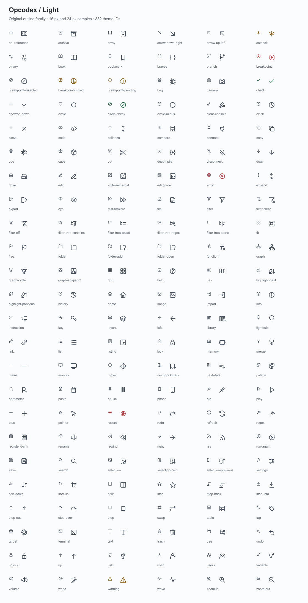
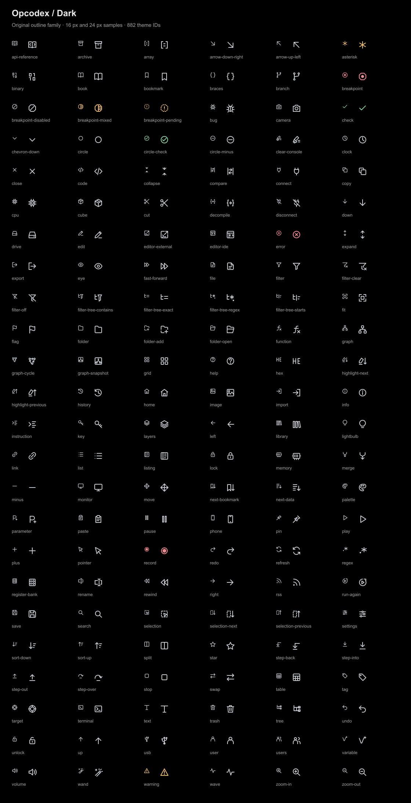

<!-- Copyright 2026 Opcodex contributors. SPDX-License-Identifier: Apache-2.0 -->

# Opcodex icon catalog

144 original outline glyphs replace 882 declared theme IDs. Transparent PNGs are exported at 16/20/24/32/48/64px; product themes paint Java2D geometry directly at display scale; multi-resolution images support image consumers and export. Registered built-in raw filename callers use live vector adapters, including startup tools. Composed aliases retain status overlays, dimensions and translations; intentional empty placeholders stay empty.

Sources: [catalog](../../ui-assets/icons/catalog.json) and [SVGs](../../ui-assets/icons/src). Regenerate with `node opcodex/generate-ui-assets.cjs` and `node opcodex/generate-design-preview.cjs` using Sharp as a development-only dependency.

## Light

## Dark

## Semantic mapping

| Existing ID | Original glyph |
|---|---|
| `icon.add` | `icon.opcodex.glyph.plus` |
| `icon.arrow.down.right` | `icon.opcodex.glyph.arrow-down-right` |
| `icon.arrow.up.left` | `icon.opcodex.glyph.arrow-up-left` |
| `icon.base.application.128` | `images/opcodex/brand/app-neutral-128.png` |
| `icon.base.application.16` | `images/opcodex/brand/app-neutral-16.png` |
| `icon.base.application.24` | `images/opcodex/brand/app-neutral-24.png` |
| `icon.base.application.256` | `images/opcodex/brand/app-neutral-256.png` |
| `icon.base.application.32` | `images/opcodex/brand/app-neutral-32.png` |
| `icon.base.application.40` | `images/opcodex/brand/app-neutral-40.png` |
| `icon.base.application.48` | `images/opcodex/brand/app-neutral-48.png` |
| `icon.base.application.64` | `images/opcodex/brand/app-neutral-64.png` |
| `icon.base.application.home` | `icon.opcodex.glyph.home` |
| `icon.base.delete` | `icon.delete` |
| `icon.base.edit.bytes` | `icon.opcodex.glyph.edit` |
| `icon.base.hover.off` | `icon.opcodex.glyph.info` |
| `icon.base.hover.on` | `icon.opcodex.glyph.info` |
| `icon.base.lock` | `icon.opcodex.glyph.lock` |
| `icon.base.mem.search.panel.options` | `icon.opcodex.glyph.split` |
| `icon.base.mem.search.panel.scan` | `icon.opcodex.glyph.split` |
| `icon.base.mem.search.panel.search` | `icon.opcodex.glyph.split` |
| `icon.base.pinned` | `icon.opcodex.glyph.pin` |
| `icon.base.plugin.quickfix.done` | `icon.checkmark.green` |
| `icon.base.plus` | `icon.add` |
| `icon.base.search.marker` | `icon.opcodex.glyph.search` |
| `icon.base.source.c` | `icon.opcodex.glyph.code` |
| `icon.base.unlock` | `icon.opcodex.glyph.unlock` |
| `icon.base.util.datatree.version.control.archive.dt.checkout.undo` | `icon.opcodex.glyph.undo` |
| `icon.base.util.fixed.bit.size.field` | `icon.pulldown` |
| `icon.base.util.listingcompare.area.markers.all` | `icon.opcodex.glyph.list` |
| `icon.base.util.listingcompare.area.markers.diff` | `icon.opcodex.glyph.compare` |
| `icon.base.util.listingcompare.area.markers.unmatched` | `icon.navigate.in` |
| `icon.base.util.listingcompare.cursor` | `icon.opcodex.glyph.pointer` |
| `icon.base.util.listingcompare.diff.next` | `icon.opcodex.glyph.sort-up` |
| `icon.base.util.listingcompare.hover.off` | `icon.base.hover.off` |
| `icon.base.util.listingcompare.hover.on` | `icon.base.hover.on` |
| `icon.base.util.listingcompare.previous.next` | `icon.opcodex.glyph.sort-down` |
| `icon.base.util.listingcompare.provider` | `icon.opcodex.glyph.compare` |
| `icon.base.util.listingdiff.diffs.byte` | `icon.opcodex.glyph.binary` |
| `icon.base.util.listingdiff.diffs.constants` | `icon.opcodex.glyph.cube` |
| `icon.base.util.listingdiff.diffs.not` | `icon.opcodex.glyph.error` |
| `icon.base.util.listingdiff.diffs.registers` | `icon.opcodex.glyph.memory` |
| `icon.base.util.viewer.fieldfactory.label` | `icon.base.pinned [move(0,4)]` |
| `icon.base.util.viewer.fieldfactory.openclose.closed` | `icon.opcodex.glyph.plus` |
| `icon.base.util.viewer.fieldfactory.openclose.open` | `icon.opcodex.glyph.minus` |
| `icon.base.util.viewer.fieldfactory.variable` | `icon.warning` |
| `icon.base.util.xml.functions.bookmark` | `icon.opcodex.glyph.import` |
| `icon.bsim.change.password` | `icon.opcodex.glyph.key` |
| `icon.bsim.connected` | `icon.opcodex.glyph.connect` |
| `icon.bsim.disconnected` | `icon.opcodex.glyph.disconnect` |
| `icon.bsim.functions.table` | `icon.opcodex.glyph.function` |
| `icon.bsim.query.dialog.provider` | `icon.opcodex.glyph.settings` |
| `icon.bsim.results.status.ignored` | `icon.opcodex.glyph.circle-check` |
| `icon.bsim.results.status.matches` | `icon.opcodex.glyph.flag` |
| `icon.bsim.results.status.name.applied` | `icon.opcodex.glyph.check` |
| `icon.bsim.results.status.signature.applied` | `EMPTY_ICON {icon.opcodex.glyph.check[move(-2,-1)]} {icon.opcodex.glyph.check [move(4,0)]}` |
| `icon.bsim.table.split` | `icon.opcodex.glyph.split` |
| `icon.bytepatterns.byte.sequence.analyzer.clipboard.merged` | `icon.opcodex.glyph.right` |
| `icon.bytepatterns.byte.sequence.analyzer.merge` | `icon.opcodex.glyph.braces` |
| `icon.bytepatterns.function.bit.patterns.disabled` | `icon.opcodex.glyph.stop` |
| `icon.bytepatterns.function.bit.patterns.enabled` | `icon.opcodex.glyph.circle-check` |
| `icon.bytepatterns.pattern.mining.analyzer` | `icon.opcodex.glyph.zoom-in` |
| `icon.bytepatterns.send.to.clipboard` | `icon.opcodex.glyph.right` |
| `icon.check` | `icon.opcodex.glyph.check` |
| `icon.checkmark.green` | `icon.opcodex.glyph.check` |
| `icon.clear` | `icon.opcodex.glyph.close` |
| `icon.collapse.all` | `icon.opcodex.glyph.collapse` |
| `icon.configure.filter` | `icon.opcodex.glyph.settings` |
| `icon.console` | `icon.opcodex.glyph.terminal` |
| `icon.content.handler.archive.dt` | `icon.opcodex.glyph.book` |
| `icon.content.handler.link` | `icon.opcodex.glyph.link` |
| `icon.content.handler.link.overlay` | `EMPTY_ICON[size(16,16)]{icon.content.handler.link[move(0,8)]}` |
| `icon.content.handler.linked.folder.closed` | `icon.datatree.node.domain.folder.closed{icon.content.handler.link.overlay}` |
| `icon.content.handler.linked.folder.open` | `icon.datatree.node.domain.folder.open{icon.content.handler.link.overlay}` |
| `icon.content.handler.program` | `icon.opcodex.glyph.code` |
| `icon.content.handler.trace` | `icon.opcodex.glyph.history` |
| `icon.copy` | `icon.opcodex.glyph.copy` |
| `icon.cut` | `icon.opcodex.glyph.cut` |
| `icon.data.type.audio.player` | `icon.opcodex.glyph.volume` |
| `icon.datatree.node.domain.file` | `icon.domain.file.uknown` |
| `icon.datatree.node.domain.folder.closed` | `icon.folder.closed` |
| `icon.datatree.node.domain.folder.open` | `icon.folder.open` |
| `icon.debugger` | `icon.opcodex.glyph.bug` |
| `icon.debugger.add` | `icon.opcodex.glyph.plus` |
| `icon.debugger.attach` | `icon.opcodex.glyph.connect` |
| `icon.debugger.autoread` | `icon.opcodex.glyph.eye` |
| `icon.debugger.blank` | `EMPTY_ICON` |
| `icon.debugger.block` | `icon.debugger.map.sections` |
| `icon.debugger.breakpoint.clear` | `icon.opcodex.glyph.breakpoint{icon.opcodex.glyph.close[size(8,8)][move(8,8)]}` |
| `icon.debugger.breakpoint.clear.all` | `icon.opcodex.glyph.breakpoint-disabled{icon.opcodex.glyph.layers[size(8,8)][move(8,8)]}` |
| `icon.debugger.breakpoint.disable` | `icon.opcodex.glyph.breakpoint-disabled` |
| `icon.debugger.breakpoint.disable.all` | `icon.opcodex.glyph.breakpoint-disabled{icon.opcodex.glyph.layers[size(8,8)][move(8,8)]}` |
| `icon.debugger.breakpoint.enable` | `icon.opcodex.glyph.breakpoint` |
| `icon.debugger.breakpoint.enable.all` | `icon.opcodex.glyph.breakpoint{icon.opcodex.glyph.layers[size(8,8)][move(8,8)]}` |
| `icon.debugger.breakpoint.make.effective` | `icon.opcodex.glyph.check` |
| `icon.debugger.breakpoint.marker.disabled` | `icon.debugger.breakpoint.disable` |
| `icon.debugger.breakpoint.marker.enabled` | `icon.debugger.breakpoint.enable` |
| `icon.debugger.breakpoint.marker.ineffective.disabled` | `icon.opcodex.glyph.breakpoint-pending` |
| `icon.debugger.breakpoint.marker.ineffective.enabled` | `icon.opcodex.glyph.breakpoint-pending` |
| `icon.debugger.breakpoint.marker.ineffective.mixed` | `icon.opcodex.glyph.breakpoint-pending` |
| `icon.debugger.breakpoint.marker.mixed` | `icon.opcodex.glyph.breakpoint-mixed` |
| `icon.debugger.breakpoint.overlay.inconsistent` | `icon.opcodex.glyph.breakpoint-pending` |
| `icon.debugger.breakpoint.set` | `icon.opcodex.glyph.breakpoint` |
| `icon.debugger.breakpoint.timeline.close_all_zoom_windows` | `icon.opcodex.glyph.trash` |
| `icon.debugger.breakpoint.timeline.grid` | `icon.opcodex.glyph.grid` |
| `icon.debugger.breakpoint.timeline.no_outline` | `icon.opcodex.glyph.trash` |
| `icon.debugger.breakpoint.timeline.outline` | `icon.opcodex.glyph.check` |
| `icon.debugger.breakpoint.timeline.single_column` | `icon.opcodex.glyph.layers` |
| `icon.debugger.breakpoint.timeline.zoom_in` | `icon.opcodex.glyph.zoom-in` |
| `icon.debugger.breakpoint.timeline.zoom_out` | `icon.opcodex.glyph.zoom-out` |
| `icon.debugger.breakpoint.timeline.zoom_out_max` | `icon.opcodex.glyph.fit` |
| `icon.debugger.capture.symbols` | `icon.opcodex.glyph.folder` |
| `icon.debugger.clear` | `icon.opcodex.glyph.cut` |
| `icon.debugger.close` | `icon.opcodex.glyph.close` |
| `icon.debugger.config` | `icon.opcodex.glyph.settings` |
| `icon.debugger.connect` | `icon.opcodex.glyph.connect` |
| `icon.debugger.connect.accept` | `icon.opcodex.glyph.import` |
| `icon.debugger.connect.outbound` | `icon.opcodex.glyph.export` |
| `icon.debugger.control.mode.ro.target` | `icon.opcodex.glyph.record` |
| `icon.debugger.control.mode.ro.trace` | `icon.opcodex.glyph.history` |
| `icon.debugger.control.mode.rw.emulator` | `icon.opcodex.glyph.cpu{icon.opcodex.glyph.edit[size(8,8)][move(8,8)]}` |
| `icon.debugger.control.mode.rw.target` | `icon.opcodex.glyph.monitor{icon.opcodex.glyph.edit[size(8,8)][move(8,8)]}` |
| `icon.debugger.control.mode.rw.trace` | `icon.opcodex.glyph.history{icon.opcodex.glyph.edit[size(8,8)][move(8,8)]}` |
| `icon.debugger.data.types` | `icon.opcodex.glyph.layers` |
| `icon.debugger.delete` | `icon.opcodex.glyph.trash` |
| `icon.debugger.detach` | `icon.opcodex.glyph.disconnect` |
| `icon.debugger.diff` | `icon.opcodex.glyph.compare` |
| `icon.debugger.diff.next` | `icon.opcodex.glyph.down` |
| `icon.debugger.diff.previous` | `icon.opcodex.glyph.up` |
| `icon.debugger.disassemble` | `icon.opcodex.glyph.edit` |
| `icon.debugger.disconnect` | `icon.opcodex.glyph.disconnect` |
| `icon.debugger.display.export.facts` | `icon.opcodex.glyph.folder` |
| `icon.debugger.display.export.xml` | `icon.opcodex.glyph.code` |
| `icon.debugger.display.graph` | `icon.opcodex.glyph.breakpoint` |
| `icon.debugger.display.import.facts` | `icon.opcodex.glyph.folder` |
| `icon.debugger.display.import.xml` | `icon.opcodex.glyph.code` |
| `icon.debugger.display.xml` | `icon.opcodex.glyph.code` |
| `icon.debugger.display.xml.filtered` | `icon.debugger.display.xml` |
| `icon.debugger.emulate` | `icon.debugger.process` |
| `icon.debugger.enable.edits` | `icon.opcodex.glyph.edit` |
| `icon.debugger.filter` | `icon.opcodex.glyph.filter-off` |
| `icon.debugger.import` | `icon.opcodex.glyph.import` |
| `icon.debugger.interrupt` | `icon.opcodex.glyph.pause` |
| `icon.debugger.kill` | `icon.opcodex.glyph.stop` |
| `icon.debugger.launch` | `icon.opcodex.glyph.play` |
| `icon.debugger.log.error` | `icon.opcodex.glyph.error` |
| `icon.debugger.log.fatal` | `icon.opcodex.glyph.error` |
| `icon.debugger.log.warn` | `icon.opcodex.glyph.warning` |
| `icon.debugger.map.auto` | `icon.debugger.config` |
| `icon.debugger.map.identically` | `icon.opcodex.glyph.swap` |
| `icon.debugger.map.manual` | `icon.debugger.provider.mappings` |
| `icon.debugger.map.modules` | `icon.opcodex.glyph.layers` |
| `icon.debugger.map.regions` | `icon.debugger.map.modules` |
| `icon.debugger.map.sections` | `icon.debugger.map.modules` |
| `icon.debugger.marker.event` | `icon.debugger.marker.register` |
| `icon.debugger.marker.register` | `icon.opcodex.glyph.flag` |
| `icon.debugger.model.table.attributes` | `icon.opcodex.glyph.table` |
| `icon.debugger.model.table.elements` | `icon.opcodex.glyph.table` |
| `icon.debugger.model.tree.objects` | `icon.opcodex.glyph.graph` |
| `icon.debugger.modules.table.sections` | `icon.opcodex.glyph.table` |
| `icon.debugger.node.object.empty` | `icon.debugger.object.unpopulated` |
| `icon.debugger.node.object.event` | `icon.opcodex.glyph.flag` |
| `icon.debugger.node.object.populated` | `icon.debugger.object.populated` |
| `icon.debugger.node.object.running` | `icon.opcodex.glyph.play` |
| `icon.debugger.node.object.terminated` | `icon.opcodex.glyph.stop` |
| `icon.debugger.object.populated` | `icon.opcodex.glyph.cube` |
| `icon.debugger.object.unpopulated` | `icon.opcodex.glyph.cube` |
| `icon.debugger.open.windbg.trace` | `icon.opcodex.glyph.code` |
| `icon.debugger.overlay.tx` | `icon.opcodex.glyph.edit` |
| `icon.debugger.package` | `icon.opcodex.glyph.bug` |
| `icon.debugger.pin` | `icon.opcodex.glyph.pin` |
| `icon.debugger.process` | `icon.opcodex.glyph.monitor` |
| `icon.debugger.processor` | `icon.opcodex.glyph.memory` |
| `icon.debugger.provider.breakpoints` | `icon.opcodex.glyph.breakpoint-mixed` |
| `icon.debugger.provider.console` | `icon.opcodex.glyph.terminal` |
| `icon.debugger.provider.listing` | `icon.opcodex.glyph.code` |
| `icon.debugger.provider.mappings` | `icon.content.handler.program` |
| `icon.debugger.provider.memory.bytes` | `icon.opcodex.glyph.binary` |
| `icon.debugger.provider.model` | `icon.opcodex.glyph.graph` |
| `icon.debugger.provider.modules` | `icon.opcodex.glyph.layers` |
| `icon.debugger.provider.objects` | `icon.debugger.object.populated` |
| `icon.debugger.provider.pcode` | `icon.opcodex.glyph.step-into` |
| `icon.debugger.provider.regions` | `icon.opcodex.glyph.memory` |
| `icon.debugger.provider.registers` | `icon.opcodex.glyph.memory` |
| `icon.debugger.provider.stack` | `icon.opcodex.glyph.layers` |
| `icon.debugger.provider.time` | `icon.opcodex.glyph.clock` |
| `icon.debugger.record` | `icon.opcodex.glyph.record` |
| `icon.debugger.refresh` | `icon.opcodex.glyph.refresh` |
| `icon.debugger.refresh.memory` | `icon.debugger.refresh` |
| `icon.debugger.rename.snapshot` | `icon.debugger.provider.time` |
| `icon.debugger.resume` | `icon.opcodex.glyph.play` |
| `icon.debugger.resume.back` | `icon.opcodex.glyph.rewind` |
| `icon.debugger.save` | `icon.save` |
| `icon.debugger.seek.present` | `icon.opcodex.glyph.target` |
| `icon.debugger.select.addresses` | `icon.opcodex.glyph.list` |
| `icon.debugger.select.registers` | `icon.opcodex.glyph.target` |
| `icon.debugger.select.rows` | `icon.opcodex.glyph.selection` |
| `icon.debugger.skip.over` | `icon.opcodex.glyph.step-over` |
| `icon.debugger.snap.backward` | `icon.opcodex.glyph.left` |
| `icon.debugger.snap.forward` | `icon.opcodex.glyph.right` |
| `icon.debugger.step.back` | `icon.opcodex.glyph.step-back` |
| `icon.debugger.step.back.into` | `icon.opcodex.glyph.step-back` |
| `icon.debugger.step.back.over` | `icon.opcodex.glyph.step-back` |
| `icon.debugger.step.finish` | `icon.opcodex.glyph.step-out` |
| `icon.debugger.step.into` | `icon.opcodex.glyph.step-into` |
| `icon.debugger.step.last` | `icon.opcodex.glyph.step-out` |
| `icon.debugger.step.over` | `icon.opcodex.glyph.step-over` |
| `icon.debugger.sync` | `icon.opcodex.glyph.swap` |
| `icon.debugger.table.object` | `icon.table` |
| `icon.debugger.thread` | `icon.opcodex.glyph.wave` |
| `icon.debugger.toggle` | `icon.opcodex.glyph.swap` |
| `icon.debugger.tree.object` | `icon.debugger.object.unpopulated` |
| `icon.debugger.unique.ref.read` | `icon.opcodex.glyph.pointer [rotate(180)]` |
| `icon.debugger.unique.ref.write` | `icon.opcodex.glyph.pointer` |
| `icon.debugger.visibility` | `icon.opcodex.glyph.text` |
| `icon.decompiler.action.export` | `icon.opcodex.glyph.export` |
| `icon.decompiler.action.provider` | `icon.opcodex.glyph.decompile` |
| `icon.decompiler.action.provider.clone` | `icon.provider.clone` |
| `icon.decompiler.action.provider.readonly` | `icon.opcodex.glyph.lock` |
| `icon.decompiler.action.provider.unreachable` | `icon.opcodex.glyph.filter-off` |
| `icon.decompiler.action.slash` | `icon.opcodex.glyph.code` |
| `icon.delete` | `icon.opcodex.glyph.trash` |
| `icon.dialog.error.expandable.cause` | `icon.opcodex.glyph.warning` |
| `icon.dialog.error.expandable.exception` | `icon.opcodex.glyph.code` |
| `icon.dialog.error.expandable.frame` | `icon.opcodex.glyph.layers` |
| `icon.dialog.error.expandable.report` | `icon.spreadsheet` |
| `icon.dialog.error.expandable.stack` | `icon.opcodex.glyph.layers` |
| `icon.docking.application.128` | `images/opcodex/brand/app-neutral-128.png` |
| `icon.docking.application.16` | `images/opcodex/brand/app-neutral-16.png` |
| `icon.docking.application.home` | `icon.opcodex.glyph.home` |
| `icon.domain.file.uknown` | `icon.opcodex.glyph.file` |
| `icon.down` | `icon.opcodex.glyph.down` |
| `icon.dragon.256` | `images/opcodex/brand/app-neutral-256.png` |
| `icon.drive` | `icon.opcodex.glyph.drive` |
| `icon.empty` | `EMPTY_ICON` |
| `icon.empty.20` | `EMPTY_ICON[size(20,20)]` |
| `icon.error` | `icon.opcodex.glyph.error` |
| `icon.expand.all` | `icon.opcodex.glyph.expand` |
| `icon.extension.configure` | `icon.opcodex.glyph.settings` |
| `icon.filechooser.default.directory` | `icon.folder.closed` |
| `icon.filechooser.default.file` | `icon.opcodex.glyph.file` |
| `icon.filechooser.places.desktop` | `icon.opcodex.glyph.monitor` |
| `icon.filechooser.places.downloads` | `icon.opcodex.glyph.import` |
| `icon.filechooser.places.home` | `icon.opcodex.glyph.home` |
| `icon.filechooser.places.my.computer` | `icon.opcodex.glyph.monitor` |
| `icon.filechooser.places.recent` | `icon.opcodex.glyph.folder {icon.opcodex.glyph.undo [move(6,10)]}` |
| `icon.filter.options.contains` | `icon.opcodex.glyph.filter` |
| `icon.filter.options.exact` | `icon.opcodex.glyph.text` |
| `icon.filter.options.not` | `icon.opcodex.glyph.circle-minus` |
| `icon.filter.options.regex` | `icon.opcodex.glyph.regex` |
| `icon.filter.options.starts.with` | `icon.opcodex.glyph.selection` |
| `icon.filter.tree.contains` | `icon.opcodex.glyph.filter-tree-contains` |
| `icon.filter.tree.exact` | `icon.opcodex.glyph.filter-tree-exact` |
| `icon.filter.tree.regex` | `icon.opcodex.glyph.filter-tree-regex` |
| `icon.filter.tree.starts` | `icon.opcodex.glyph.filter-tree-starts` |
| `icon.flag` | `icon.opcodex.glyph.flag` |
| `icon.folder.closed` | `icon.opcodex.glyph.folder` |
| `icon.folder.new` | `icon.opcodex.glyph.folder-add` |
| `icon.folder.open` | `icon.opcodex.glyph.folder-open` |
| `icon.font` | `icon.opcodex.glyph.text` |
| `icon.frontend.project.connected` | `icon.opcodex.glyph.connect` |
| `icon.frontend.project.disconnected` | `icon.opcodex.glyph.disconnect` |
| `icon.fsbrowser.file.extension.apk` | `icon.opcodex.glyph.archive` |
| `icon.fsbrowser.file.extension.bat` | `icon.opcodex.glyph.terminal` |
| `icon.fsbrowser.file.extension.bz` | `icon.opcodex.glyph.archive` |
| `icon.fsbrowser.file.extension.bz2` | `icon.opcodex.glyph.archive` |
| `icon.fsbrowser.file.extension.c` | `icon.opcodex.glyph.code` |
| `icon.fsbrowser.file.extension.class` | `icon.opcodex.glyph.braces` |
| `icon.fsbrowser.file.extension.cpio` | `icon.opcodex.glyph.archive` |
| `icon.fsbrowser.file.extension.cpp` | `icon.opcodex.glyph.code` |
| `icon.fsbrowser.file.extension.cs` | `icon.opcodex.glyph.code` |
| `icon.fsbrowser.file.extension.css` | `icon.opcodex.glyph.code` |
| `icon.fsbrowser.file.extension.data` | `icon.opcodex.glyph.drive` |
| `icon.fsbrowser.file.extension.default` | `icon.opcodex.glyph.file` |
| `icon.fsbrowser.file.extension.dfu` | `icon.opcodex.glyph.circle-minus` |
| `icon.fsbrowser.file.extension.dll` | `icon.opcodex.glyph.monitor` |
| `icon.fsbrowser.file.extension.dmg` | `icon.opcodex.glyph.circle-check` |
| `icon.fsbrowser.file.extension.dylib` | `icon.opcodex.glyph.monitor` |
| `icon.fsbrowser.file.extension.exe` | `icon.opcodex.glyph.monitor` |
| `icon.fsbrowser.file.extension.f` | `icon.opcodex.glyph.text` |
| `icon.fsbrowser.file.extension.gif` | `icon.opcodex.glyph.image` |
| `icon.fsbrowser.file.extension.gz` | `icon.opcodex.glyph.archive` |
| `icon.fsbrowser.file.extension.h` | `icon.opcodex.glyph.code` |
| `icon.fsbrowser.file.extension.html` | `icon.opcodex.glyph.code` |
| `icon.fsbrowser.file.extension.img` | `icon.opcodex.glyph.image` |
| `icon.fsbrowser.file.extension.img3` | `icon.opcodex.glyph.asterisk` |
| `icon.fsbrowser.file.extension.index` | `icon.opcodex.glyph.bookmark` |
| `icon.fsbrowser.file.extension.ipsw` | `icon.opcodex.glyph.phone` |
| `icon.fsbrowser.file.extension.iso` | `icon.opcodex.glyph.drive` |
| `icon.fsbrowser.file.extension.jar` | `icon.opcodex.glyph.archive` |
| `icon.fsbrowser.file.extension.java` | `icon.opcodex.glyph.braces` |
| `icon.fsbrowser.file.extension.jpeg` | `icon.opcodex.glyph.image` |
| `icon.fsbrowser.file.extension.jpg` | `icon.opcodex.glyph.image` |
| `icon.fsbrowser.file.extension.js` | `icon.opcodex.glyph.code` |
| `icon.fsbrowser.file.extension.kext` | `icon.opcodex.glyph.circle` |
| `icon.fsbrowser.file.extension.lib` | `icon.opcodex.glyph.drive` |
| `icon.fsbrowser.file.extension.o` | `icon.opcodex.glyph.binary` |
| `icon.fsbrowser.file.extension.obj` | `icon.opcodex.glyph.binary` |
| `icon.fsbrowser.file.extension.p` | `icon.opcodex.glyph.code` |
| `icon.fsbrowser.file.extension.pdf` | `icon.opcodex.glyph.file` |
| `icon.fsbrowser.file.extension.plist` | `icon.opcodex.glyph.table` |
| `icon.fsbrowser.file.extension.png` | `icon.opcodex.glyph.image` |
| `icon.fsbrowser.file.extension.py` | `icon.opcodex.glyph.code` |
| `icon.fsbrowser.file.extension.rss` | `icon.opcodex.glyph.rss` |
| `icon.fsbrowser.file.extension.sh` | `icon.opcodex.glyph.terminal` |
| `icon.fsbrowser.file.extension.so` | `icon.opcodex.glyph.monitor` |
| `icon.fsbrowser.file.extension.strings` | `icon.opcodex.glyph.text` |
| `icon.fsbrowser.file.extension.tar` | `icon.opcodex.glyph.archive` |
| `icon.fsbrowser.file.extension.tgz` | `icon.opcodex.glyph.archive` |
| `icon.fsbrowser.file.extension.txt` | `icon.opcodex.glyph.text` |
| `icon.fsbrowser.file.extension.usb` | `icon.opcodex.glyph.usb` |
| `icon.fsbrowser.file.extension.xhtml` | `icon.opcodex.glyph.code` |
| `icon.fsbrowser.file.extension.xml` | `icon.opcodex.glyph.code` |
| `icon.fsbrowser.file.extension.xz` | `icon.opcodex.glyph.archive` |
| `icon.fsbrowser.file.extension.zip` | `icon.opcodex.glyph.archive` |
| `icon.fsbrowser.file.overlay.filesystem` | `EMPTY_ICON{icon.opcodex.glyph.circle-check[size(8,8)][move(0,8)]}` |
| `icon.fsbrowser.file.overlay.imported` | `EMPTY_ICON{icon.opcodex.glyph.check[size(8,8)][move(8,8)]}` |
| `icon.fsbrowser.file.overlay.link` | `EMPTY_ICON{icon.content.handler.link[move(0,8)]}` |
| `icon.fsbrowser.file.overlay.missing.password` | `EMPTY_ICON{icon.opcodex.glyph.lock[size(8,8)][move(8,0)]}` |
| `icon.fsbrowser.file.substring.release.` | `icon.opcodex.glyph.circle-minus` |
| `icon.fsbrowser.file.substring.so.` | `icon.opcodex.glyph.monitor` |
| `icon.graph.default.display.fit.to.window` | `icon.opcodex.glyph.fit` |
| `icon.graph.default.display.lasso` | `icon.opcodex.glyph.selection` |
| `icon.graph.default.display.layout.algorithm` | `icon.opcodex.glyph.graph` |
| `icon.graph.default.display.program.graph` | `icon.opcodex.glyph.graph` |
| `icon.graph.default.display.satellite.view` | `icon.opcodex.glyph.tree` |
| `icon.graph.default.display.view.magnifier` | `icon.opcodex.glyph.zoom-in` |
| `icon.graph.layout.default` | `icon.opcodex.glyph.grid` |
| `icon.graph.satellite` | `icon.opcodex.glyph.tree` |
| `icon.graph.satellite.large` | `icon.opcodex.glyph.tree` |
| `icon.help` | `icon.opcodex.glyph.help` |
| `icon.help.navigation.aid.disabled.overlay` | `icon.not.allowed` |
| `icon.help.navigation.aid.enabled` | `icon.opcodex.glyph.lightbulb` |
| `icon.home` | `icon.opcodex.glyph.home` |
| `icon.information` | `icon.opcodex.glyph.info` |
| `icon.left` | `icon.opcodex.glyph.left` |
| `icon.left.alt` | `icon.opcodex.glyph.left` |
| `icon.lock` | `icon.opcodex.glyph.lock` |
| `icon.logviewer.toolbar.file.open` | `icon.folder.open` |
| `icon.logviewer.toolbar.scroll.lock` | `icon.opcodex.glyph.lock` |
| `icon.make.selection` | `icon.opcodex.glyph.selection` |
| `icon.menu.file.new.project` | `icon.folder.new` |
| `icon.navigate.in` | `icon.opcodex.glyph.import` |
| `icon.navigate.out` | `icon.opcodex.glyph.export` |
| `icon.not.allowed` | `icon.opcodex.glyph.error` |
| `icon.opcodex.splash` | `images/opcodex/brand/splash-light.png` |
| `icon.paste` | `icon.opcodex.glyph.paste` |
| `icon.pending` | `icon.opcodex.glyph.clock` |
| `icon.plugin.assembler.question` | `icon.opcodex.glyph.help` |
| `icon.plugin.bookmark.add` | `icon.check` |
| `icon.plugin.bookmark.delete` | `icon.base.delete` |
| `icon.plugin.bookmark.select` | `icon.opcodex.glyph.list` |
| `icon.plugin.bookmark.type.analysis` | `icon.opcodex.glyph.wand` |
| `icon.plugin.bookmark.type.default` | `icon.opcodex.glyph.help` |
| `icon.plugin.bookmark.type.error` | `icon.base.delete` |
| `icon.plugin.bookmark.type.info` | `icon.information` |
| `icon.plugin.bookmark.type.note` | `icon.opcodex.glyph.bookmark` |
| `icon.plugin.bookmark.type.warning` | `icon.warning` |
| `icon.plugin.bundlemanager.disable` | `icon.opcodex.glyph.stop` |
| `icon.plugin.bundlemanager.enable` | `icon.opcodex.glyph.play` |
| `icon.plugin.byteviewer.options` | `icon.opcodex.glyph.settings` |
| `icon.plugin.byteviewer.provider` | `icon.opcodex.glyph.binary` |
| `icon.plugin.calltree.filter.non.calls` | `icon.opcodex.glyph.link` |
| `icon.plugin.calltree.filter.select.source` | `icon.opcodex.glyph.list` |
| `icon.plugin.calltree.function` | `icon.opcodex.glyph.function` |
| `icon.plugin.calltree.node.dead.end` | `icon.opcodex.glyph.stop` |
| `icon.plugin.calltree.node.external` | `icon.opcodex.glyph.export` |
| `icon.plugin.calltree.recursive` | `icon.opcodex.glyph.refresh` |
| `icon.plugin.calltree.reference` | `icon.opcodex.glyph.link [size(12,12)][move(4,4)]` |
| `icon.plugin.calltree.refresh` | `icon.refresh` |
| `icon.plugin.calltree.refresh.not.needed` | `icon.plugin.calltree.refresh [disabled]` |
| `icon.plugin.calltree.unify.functions` | `icon.opcodex.glyph.layers` |
| `icon.plugin.checksum.carry` | `icon.opcodex.glyph.up` |
| `icon.plugin.checksum.compute` | `icon.refresh` |
| `icon.plugin.checksum.ones.complement` | `icon.opcodex.glyph.minus` |
| `icon.plugin.checksum.select` | `icon.opcodex.glyph.selection` |
| `icon.plugin.checksum.show.hex` | `icon.opcodex.glyph.hex` |
| `icon.plugin.checksum.twos.complement` | `icon.opcodex.glyph.plus` |
| `icon.plugin.checksum.xor` | `icon.opcodex.glyph.braces` |
| `icon.plugin.clipboard.copy` | `icon.copy` |
| `icon.plugin.clipboard.paste` | `icon.paste` |
| `icon.plugin.codebrowser.cursor.location` | `icon.opcodex.glyph.right` |
| `icon.plugin.codebrowser.cursor.marker` | `icon.opcodex.glyph.search` |
| `icon.plugin.codebrowser.format.collapse` | `icon.opcodex.glyph.up` |
| `icon.plugin.codebrowser.format.expand` | `icon.opcodex.glyph.down` |
| `icon.plugin.codebrowser.hover.off` | `icon.base.hover.off` |
| `icon.plugin.codebrowser.hover.on` | `icon.base.hover.on` |
| `icon.plugin.codebrowser.mark.and.select.armed` | `icon.opcodex.glyph.selection {icon.opcodex.glyph.play[size(12,12)][move(4,4)]}` |
| `icon.plugin.codebrowser.mark.and.select.unarmed` | `icon.opcodex.glyph.selection {icon.opcodex.glyph.stop[size(12,12)][move(4,4)]}` |
| `icon.plugin.codebrowser.provider` | `icon.opcodex.glyph.listing` |
| `icon.plugin.composite.editor.apply` | `icon.opcodex.glyph.save` |
| `icon.plugin.composite.editor.array` | `icon.opcodex.glyph.array` |
| `icon.plugin.composite.editor.bit.field.dialog.add` | `icon.base.plus` |
| `icon.plugin.composite.editor.bit.field.dialog.delete` | `icon.base.delete` |
| `icon.plugin.composite.editor.bit.field.dialog.edit` | `icon.opcodex.glyph.move` |
| `icon.plugin.composite.editor.bit.field.editor.decrement` | `icon.opcodex.glyph.minus` |
| `icon.plugin.composite.editor.bit.field.editor.increment` | `icon.base.plus` |
| `icon.plugin.composite.editor.clear` | `icon.clear` |
| `icon.plugin.composite.editor.create` | `icon.plugin.datatypes.structure` |
| `icon.plugin.composite.editor.delete` | `icon.base.delete` |
| `icon.plugin.composite.editor.duplicate` | `icon.opcodex.glyph.copy` |
| `icon.plugin.composite.editor.duplicate.multiple` | `icon.opcodex.glyph.copy` |
| `icon.plugin.composite.editor.insert.undefined` | `icon.base.plus` |
| `icon.plugin.composite.editor.move.down` | `icon.opcodex.glyph.down` |
| `icon.plugin.composite.editor.move.up` | `icon.opcodex.glyph.up` |
| `icon.plugin.composite.editor.provider` | `icon.opcodex.glyph.edit` |
| `icon.plugin.composite.editor.provider.structure` | `icon.plugin.datatypes.structure` |
| `icon.plugin.composite.editor.provider.union` | `icon.opcodex.glyph.cube` |
| `icon.plugin.composite.editor.search.next` | `icon.opcodex.glyph.down [size(16,16)]` |
| `icon.plugin.composite.editor.search.previous` | `icon.opcodex.glyph.up [size(16,16)]` |
| `icon.plugin.composite.editor.show.type` | `icon.home` |
| `icon.plugin.composite.editor.unpackage` | `icon.opcodex.glyph.archive` |
| `icon.plugin.console.clear` | `icon.opcodex.glyph.clear-console` |
| `icon.plugin.console.provider` | `icon.opcodex.glyph.terminal` |
| `icon.plugin.console.scroll.lock` | `icon.opcodex.glyph.lock` |
| `icon.plugin.datagraph.action.viewer.reset` | `icon.refresh` |
| `icon.plugin.datagraph.action.viewer.vertex.format` | `icon.opcodex.glyph.table` |
| `icon.plugin.datatypes.archive.built.in.closed` | `icon.opcodex.glyph.book` |
| `icon.plugin.datatypes.archive.built.in.open` | `icon.opcodex.glyph.book` |
| `icon.plugin.datatypes.archive.file.closed` | `icon.opcodex.glyph.book` |
| `icon.plugin.datatypes.archive.file.open` | `icon.opcodex.glyph.book` |
| `icon.plugin.datatypes.archive.invalid` | `icon.opcodex.glyph.warning` |
| `icon.plugin.datatypes.archive.program.closed` | `icon.opcodex.glyph.book` |
| `icon.plugin.datatypes.archive.program.open` | `icon.opcodex.glyph.book` |
| `icon.plugin.datatypes.archive.project.closed` | `icon.opcodex.glyph.book` |
| `icon.plugin.datatypes.archive.project.open` | `icon.opcodex.glyph.book` |
| `icon.plugin.datatypes.associate.single.type` | `icon.opcodex.glyph.left` |
| `icon.plugin.datatypes.built.in` | `icon.opcodex.glyph.cube` |
| `icon.plugin.datatypes.built.in.disabled` | `icon.opcodex.glyph.cube [disabled]` |
| `icon.plugin.datatypes.commit.single.type` | `icon.opcodex.glyph.right` |
| `icon.plugin.datatypes.conflict.mode.rename.and.add` | `icon.opcodex.glyph.edit` |
| `icon.plugin.datatypes.conflict.mode.replace.existing` | `icon.opcodex.glyph.swap` |
| `icon.plugin.datatypes.conflict.mode.replace.or.rename` | `icon.opcodex.glyph.compare` |
| `icon.plugin.datatypes.conflict.mode.use.existing` | `icon.opcodex.glyph.check` |
| `icon.plugin.datatypes.default` | `icon.opcodex.glyph.binary` |
| `icon.plugin.datatypes.default.disabled` | `icon.opcodex.glyph.binary` |
| `icon.plugin.datatypes.enum` | `icon.opcodex.glyph.table` |
| `icon.plugin.datatypes.filter.arrays.off` | `icon.opcodex.glyph.array` |
| `icon.plugin.datatypes.filter.arrays.on` | `icon.opcodex.glyph.array` |
| `icon.plugin.datatypes.filter.pointers.off` | `icon.opcodex.glyph.pointer` |
| `icon.plugin.datatypes.filter.pointers.on` | `icon.opcodex.glyph.pointer` |
| `icon.plugin.datatypes.function` | `icon.opcodex.glyph.function` |
| `icon.plugin.datatypes.pointer` | `icon.opcodex.glyph.right` |
| `icon.plugin.datatypes.provider` | `icon.opcodex.glyph.layers` |
| `icon.plugin.datatypes.structure` | `icon.opcodex.glyph.grid` |
| `icon.plugin.datatypes.tree.change.local` | `icon.opcodex.glyph.right` |
| `icon.plugin.datatypes.tree.change.source` | `icon.opcodex.glyph.left` |
| `icon.plugin.datatypes.tree.conflict` | `icon.opcodex.glyph.swap` |
| `icon.plugin.datatypes.tree.missing` | `icon.opcodex.glyph.help` |
| `icon.plugin.datatypes.tree.node.archive.file.checked.out` | `icon.check` |
| `icon.plugin.datatypes.tree.node.archive.file.checked.out.exclusive` | `icon.opcodex.glyph.lock` |
| `icon.plugin.datatypes.tree.node.archive.file.checked.out.not.latest` | `icon.opcodex.glyph.history` |
| `icon.plugin.datatypes.tree.node.archive.file.hijacked` | `icon.opcodex.glyph.warning` |
| `icon.plugin.datatypes.tree.node.archive.file.read.only` | `icon.opcodex.glyph.user [size(10,10)]` |
| `icon.plugin.datatypes.typedef` | `icon.opcodex.glyph.tag` |
| `icon.plugin.datatypes.union` | `icon.opcodex.glyph.layers` |
| `icon.plugin.datatypes.util.closed.archive` | `icon.opcodex.glyph.archive` |
| `icon.plugin.datatypes.util.closed.folder` | `icon.opcodex.glyph.folder` |
| `icon.plugin.datatypes.util.closed.folder.disabled` | `icon.opcodex.glyph.folder` |
| `icon.plugin.datatypes.util.closed.folder.locked` | `icon.opcodex.glyph.lock` |
| `icon.plugin.datatypes.util.favorite` | `icon.opcodex.glyph.star` |
| `icon.plugin.datatypes.util.favorite.disabled` | `icon.opcodex.glyph.star [disabled]` |
| `icon.plugin.datatypes.util.open.archive` | `icon.opcodex.glyph.archive` |
| `icon.plugin.datatypes.util.open.folder` | `icon.opcodex.glyph.folder-open` |
| `icon.plugin.datatypes.util.open.folder.disabled` | `icon.opcodex.glyph.folder-open` |
| `icon.plugin.datatypes.util.open.folder.locked` | `icon.opcodex.glyph.lock` |
| `icon.plugin.datatypes.util.open.root` | `icon.opcodex.glyph.library` |
| `icon.plugin.datatypes.util.root` | `icon.opcodex.glyph.library` |
| `icon.plugin.datawindow.provider` | `icon.opcodex.glyph.table` |
| `icon.plugin.debug.dbviewer.provider` | `icon.opcodex.glyph.fit` |
| `icon.plugin.debug.domaineventviewer.provider` | `icon.console` |
| `icon.plugin.debug.propertymanager.marker` | `icon.opcodex.glyph.search` |
| `icon.plugin.debug.propertymanager.provider` | `icon.opcodex.glyph.file` |
| `icon.plugin.decompiler.taint.default.query` | `icon.opcodex.glyph.search` |
| `icon.plugin.decompiler.taint.gate.set` | `icon.opcodex.glyph.flag` |
| `icon.plugin.decompiler.text.finder.select.functions` | `icon.make.selection {icon.opcodex.glyph.function[size(12,12)][move(6,6)]}` |
| `icon.plugin.enum.editor.add` | `icon.base.plus` |
| `icon.plugin.enum.editor.apply` | `icon.save` |
| `icon.plugin.enum.editor.delete` | `icon.base.delete` |
| `icon.plugin.enum.editor.home` | `icon.home` |
| `icon.plugin.enum.editor.provider` | `icon.plugin.datatypes.enum` |
| `icon.plugin.fcg.layout.bow.tie` | `icon.opcodex.glyph.grid` |
| `icon.plugin.fsbrowser.close` | `icon.opcodex.glyph.close` |
| `icon.plugin.fsbrowser.collapse.all` | `icon.opcodex.glyph.collapse` |
| `icon.plugin.fsbrowser.compress` | `icon.opcodex.glyph.archive` |
| `icon.plugin.fsbrowser.copy` | `icon.copy` |
| `icon.plugin.fsbrowser.create.firmware` | `icon.opcodex.glyph.cpu` |
| `icon.plugin.fsbrowser.cut` | `icon.cut` |
| `icon.plugin.fsbrowser.delete` | `icon.opcodex.glyph.trash` |
| `icon.plugin.fsbrowser.eclipse` | `icon.opcodex.glyph.code` |
| `icon.plugin.fsbrowser.expand.all` | `icon.opcodex.glyph.expand` |
| `icon.plugin.fsbrowser.extract` | `icon.opcodex.glyph.archive` |
| `icon.plugin.fsbrowser.font` | `icon.font` |
| `icon.plugin.fsbrowser.import` | `icon.opcodex.glyph.import` |
| `icon.plugin.fsbrowser.info` | `icon.information` |
| `icon.plugin.fsbrowser.ios` | `icon.opcodex.glyph.phone` |
| `icon.plugin.fsbrowser.jar` | `icon.opcodex.glyph.braces` |
| `icon.plugin.fsbrowser.library` | `icon.opcodex.glyph.library` |
| `icon.plugin.fsbrowser.list.mounted` | `icon.opcodex.glyph.down` |
| `icon.plugin.fsbrowser.locked` | `icon.base.lock` |
| `icon.plugin.fsbrowser.new` | `icon.opcodex.glyph.plus` |
| `icon.plugin.fsbrowser.open` | `icon.opcodex.glyph.folder-open` |
| `icon.plugin.fsbrowser.open.all` | `icon.opcodex.glyph.layers` |
| `icon.plugin.fsbrowser.open.as.binary` | `icon.opcodex.glyph.cpu` |
| `icon.plugin.fsbrowser.open.file.system` | `icon.opcodex.glyph.folder` |
| `icon.plugin.fsbrowser.open.in.listing` | `icon.opcodex.glyph.table` |
| `icon.plugin.fsbrowser.paste` | `icon.paste` |
| `icon.plugin.fsbrowser.photo` | `icon.opcodex.glyph.image` |
| `icon.plugin.fsbrowser.redo` | `icon.redo` |
| `icon.plugin.fsbrowser.refresh` | `icon.refresh` |
| `icon.plugin.fsbrowser.rename` | `icon.rename` |
| `icon.plugin.fsbrowser.save` | `icon.save` |
| `icon.plugin.fsbrowser.save.as` | `icon.save.as` |
| `icon.plugin.fsbrowser.undo` | `icon.undo` |
| `icon.plugin.fsbrowser.unlocked` | `icon.base.unlock` |
| `icon.plugin.fsbrowser.view.as.image` | `icon.opcodex.glyph.image` |
| `icon.plugin.fsbrowser.view.as.text` | `icon.opcodex.glyph.text` |
| `icon.plugin.functioncompare.function.next` | `icon.opcodex.glyph.down [move(3,1)] {icon.opcodex.glyph.function [move(-5,-2)]}` |
| `icon.plugin.functioncompare.function.previous` | `icon.opcodex.glyph.up [move(3,1)] {icon.opcodex.glyph.function [move(-5,-2)]}` |
| `icon.plugin.functioncompare.function.remove` | `icon.opcodex.glyph.trash [move(3,3)] {icon.opcodex.glyph.function [move(-5,-2)]}` |
| `icon.plugin.functioncompare.new` | `icon.opcodex.glyph.code {icon.opcodex.glyph.star [size(16,16)][move(4,-4)]}` |
| `icon.plugin.functioncompare.open.function.table` | `icon.opcodex.glyph.code {icon.add [size(8,8)][move(8,8)]}` |
| `icon.plugin.functioncompare.scroll.lock` | `icon.base.lock` |
| `icon.plugin.functioncompare.scroll.unlock` | `icon.base.unlock` |
| `icon.plugin.functiongraph.action.provider` | `icon.opcodex.glyph.graph` |
| `icon.plugin.functiongraph.action.provider.satellite` | `icon.opcodex.glyph.grid` |
| `icon.plugin.functiongraph.action.vertex.choose.color` | `icon.opcodex.glyph.palette` |
| `icon.plugin.functiongraph.action.vertex.choose.color.palette` | `icon.opcodex.glyph.grid` |
| `icon.plugin.functiongraph.action.vertex.edit.format` | `icon.opcodex.glyph.table` |
| `icon.plugin.functiongraph.action.vertex.edit.label` | `icon.opcodex.glyph.tag` |
| `icon.plugin.functiongraph.action.vertex.full.screen` | `icon.opcodex.glyph.expand` |
| `icon.plugin.functiongraph.action.vertex.group` | `icon.opcodex.glyph.layers` |
| `icon.plugin.functiongraph.action.vertex.group.add` | `icon.opcodex.glyph.plus` |
| `icon.plugin.functiongraph.action.vertex.maximize` | `icon.opcodex.glyph.expand` |
| `icon.plugin.functiongraph.action.vertex.minimize` | `icon.opcodex.glyph.collapse` |
| `icon.plugin.functiongraph.action.vertex.regroup` | `icon.opcodex.glyph.layers` |
| `icon.plugin.functiongraph.action.vertex.ungroup` | `icon.opcodex.glyph.expand` |
| `icon.plugin.functiongraph.action.vertex.xrefs` | `icon.opcodex.glyph.link` |
| `icon.plugin.functiongraph.action.viewer.clone` | `icon.opcodex.glyph.graph-snapshot` |
| `icon.plugin.functiongraph.action.viewer.home` | `icon.opcodex.glyph.home` |
| `icon.plugin.functiongraph.action.viewer.layout` | `icon.opcodex.glyph.settings` |
| `icon.plugin.functiongraph.action.viewer.reset` | `icon.opcodex.glyph.refresh` |
| `icon.plugin.functiongraph.action.viewer.vertex.hover.cycles` | `icon.opcodex.glyph.refresh` |
| `icon.plugin.functiongraph.action.viewer.vertex.hover.cycles.all` | `icon.opcodex.glyph.graph-cycle` |
| `icon.plugin.functiongraph.action.viewer.vertex.hover.off` | `icon.opcodex.glyph.filter-off` |
| `icon.plugin.functiongraph.action.viewer.vertex.hover.paths.all` | `icon.opcodex.glyph.graph` |
| `icon.plugin.functiongraph.action.viewer.vertex.hover.paths.from.to.vertex` | `icon.opcodex.glyph.link` |
| `icon.plugin.functiongraph.action.viewer.vertex.hover.paths.from.vertex` | `icon.opcodex.glyph.right` |
| `icon.plugin.functiongraph.action.viewer.vertex.hover.paths.to.vertex` | `icon.opcodex.glyph.left` |
| `icon.plugin.functiongraph.action.viewer.vertex.hover.scoped.flow.forward` | `icon.opcodex.glyph.right` |
| `icon.plugin.functiongraph.action.viewer.vertex.hover.scoped.flow.reverse` | `icon.opcodex.glyph.left` |
| `icon.plugin.functiongraph.layout.experimental` | `icon.opcodex.glyph.graph` |
| `icon.plugin.functiongraph.layout.flowchart` | `icon.opcodex.glyph.graph` |
| `icon.plugin.functiongraph.layout.flowchart.left` | `icon.opcodex.glyph.graph` |
| `icon.plugin.functiongraph.layout.nested.code` | `icon.opcodex.glyph.graph` |
| `icon.plugin.functiontags.add` | `icon.opcodex.glyph.right [size(16,16)]` |
| `icon.plugin.functiontags.remove` | `icon.opcodex.glyph.left [size(16,16)]` |
| `icon.plugin.functionwindow.provider` | `icon.opcodex.glyph.function` |
| `icon.plugin.instructiontable.address` | `icon.opcodex.glyph.target` |
| `icon.plugin.instructiontable.binary` | `icon.opcodex.glyph.binary` |
| `icon.plugin.instructiontable.hex` | `icon.opcodex.glyph.hex` |
| `icon.plugin.instructiontable.manual.entry` | `icon.base.edit.bytes` |
| `icon.plugin.instructiontable.operand` | `icon.opcodex.glyph.parameter` |
| `icon.plugin.instructiontable.scalar` | `icon.opcodex.glyph.text` |
| `icon.plugin.instructiontable.undefined` | `icon.opcodex.glyph.binary` |
| `icon.plugin.interpreter.provider` | `icon.console` |
| `icon.plugin.jython` | `icon.opcodex.glyph.code` |
| `icon.plugin.locationreferences.highlight` | `icon.opcodex.glyph.tag` |
| `icon.plugin.manager.default` | `icon.opcodex.glyph.grid` |
| `icon.plugin.memorymap.add` | `icon.add` |
| `icon.plugin.memorymap.delete` | `icon.delete` |
| `icon.plugin.memorymap.expand.down` | `icon.toggle.expand` |
| `icon.plugin.memorymap.expand.up` | `icon.toggle.collapse` |
| `icon.plugin.memorymap.image.base` | `icon.opcodex.glyph.home` |
| `icon.plugin.memorymap.merge` | `icon.opcodex.glyph.merge` |
| `icon.plugin.memorymap.move` | `icon.opcodex.glyph.move` |
| `icon.plugin.memorymap.provider` | `icon.opcodex.glyph.memory` |
| `icon.plugin.memorymap.split` | `icon.opcodex.glyph.split` |
| `icon.plugin.merge` | `icon.opcodex.glyph.merge` |
| `icon.plugin.merge.changed` | `icon.opcodex.glyph.edit` |
| `icon.plugin.merge.conflict.collapse` | `icon.toggle.collapse` |
| `icon.plugin.merge.conflict.expand` | `icon.toggle.expand` |
| `icon.plugin.merge.conflict.lock` | `icon.opcodex.glyph.lock` |
| `icon.plugin.merge.conflict.unlock` | `icon.opcodex.glyph.unlock` |
| `icon.plugin.merge.status.complete` | `icon.checkmark.green` |
| `icon.plugin.merge.status.in.progress` | `icon.opcodex.glyph.right` |
| `icon.plugin.merge.status.pending` | `icon.opcodex.glyph.circle-check` |
| `icon.plugin.myprogramchanges.checkin` | `icon.opcodex.glyph.export` |
| `icon.plugin.myprogramchanges.merge` | `icon.opcodex.glyph.merge` |
| `icon.plugin.navigation.bookmark` | `icon.opcodex.glyph.next-bookmark` |
| `icon.plugin.navigation.bookmark.analysis` | `icon.opcodex.glyph.wand` |
| `icon.plugin.navigation.bookmark.error` | `icon.error` |
| `icon.plugin.navigation.bookmark.info` | `icon.information` |
| `icon.plugin.navigation.bookmark.note` | `icon.opcodex.glyph.bookmark` |
| `icon.plugin.navigation.bookmark.unknown` | `icon.opcodex.glyph.help` |
| `icon.plugin.navigation.bookmark.warning` | `icon.warning` |
| `icon.plugin.navigation.bytes` | `icon.opcodex.glyph.grid` |
| `icon.plugin.navigation.data` | `icon.opcodex.glyph.next-data` |
| `icon.plugin.navigation.function` | `icon.opcodex.glyph.function` |
| `icon.plugin.navigation.highlight.range.next` | `icon.opcodex.glyph.highlight-next` |
| `icon.plugin.navigation.highlight.range.previous` | `icon.opcodex.glyph.highlight-previous` |
| `icon.plugin.navigation.instruction` | `icon.opcodex.glyph.instruction` |
| `icon.plugin.navigation.label` | `icon.opcodex.glyph.tag` |
| `icon.plugin.navigation.location.next` | `icon.right` |
| `icon.plugin.navigation.location.previous` | `icon.left` |
| `icon.plugin.navigation.selection.range.next` | `icon.opcodex.glyph.selection-next` |
| `icon.plugin.navigation.selection.range.previous` | `icon.opcodex.glyph.selection-previous` |
| `icon.plugin.navigation.undefined` | `icon.opcodex.glyph.help` |
| `icon.plugin.overview.provider` | `icon.opcodex.glyph.text` |
| `icon.plugin.programdiff.apply` | `icon.opcodex.glyph.edit` |
| `icon.plugin.programdiff.apply.next` | `icon.opcodex.glyph.export` |
| `icon.plugin.programdiff.cursor.location` | `icon.opcodex.glyph.pointer` |
| `icon.plugin.programdiff.get.diffs` | `icon.opcodex.glyph.compare` |
| `icon.plugin.programdiff.ignore` | `icon.opcodex.glyph.cut` |
| `icon.plugin.programdiff.open.close.program` | `icon.opcodex.glyph.compare` |
| `icon.plugin.programdiff.select.by.program` | `icon.opcodex.glyph.selection` |
| `icon.plugin.programdiff.settings` | `icon.opcodex.glyph.settings` |
| `icon.plugin.programmanager.busy` | `icon.base.edit.bytes` |
| `icon.plugin.programmanager.close` | `icon.opcodex.glyph.close` |
| `icon.plugin.programmanager.close.highlight` | `icon.opcodex.glyph.close` |
| `icon.plugin.programmanager.empty.small` | `EMPTY_ICON[size(8,16)]` |
| `icon.plugin.programmanager.list` | `icon.opcodex.glyph.fast-forward` |
| `icon.plugin.programmanager.transient` | `icon.opcodex.glyph.link` |
| `icon.plugin.programtree.closed.folder` | `icon.opcodex.glyph.folder` |
| `icon.plugin.programtree.docs` | `icon.opcodex.glyph.book` |
| `icon.plugin.programtree.drag.copy` | `icon.opcodex.glyph.move` |
| `icon.plugin.programtree.drag.move` | `icon.opcodex.glyph.copy` |
| `icon.plugin.programtree.fragment` | `icon.opcodex.glyph.code` |
| `icon.plugin.programtree.fragment.closed.folder` | `icon.opcodex.glyph.folder` |
| `icon.plugin.programtree.fragment.empty` | `icon.opcodex.glyph.file` |
| `icon.plugin.programtree.fragment.open.folder` | `icon.opcodex.glyph.folder-open` |
| `icon.plugin.programtree.fragment.viewed` | `icon.opcodex.glyph.code` |
| `icon.plugin.programtree.fragment.viewed.closed.folder.with.description` | `icon.opcodex.glyph.folder` |
| `icon.plugin.programtree.fragment.viewed.empty` | `icon.opcodex.glyph.file` |
| `icon.plugin.programtree.new.tree` | `icon.opcodex.glyph.folder-add` |
| `icon.plugin.programtree.open.folder` | `icon.opcodex.glyph.folder-open` |
| `icon.plugin.programtree.open.tree` | `icon.folder.open` |
| `icon.plugin.python` | `icon.opcodex.glyph.code` |
| `icon.plugin.reachability.provider` | `icon.opcodex.glyph.graph [rotate(90)]` |
| `icon.plugin.register` | `icon.opcodex.glyph.memory` |
| `icon.plugin.register.group` | `icon.opcodex.glyph.memory` |
| `icon.plugin.register.provider` | `icon.opcodex.glyph.register-bank` |
| `icon.plugin.scalartable.provider` | `icon.opcodex.glyph.table` |
| `icon.plugin.scriptmanager.api` | `icon.opcodex.glyph.api-reference` |
| `icon.plugin.scriptmanager.delete` | `icon.delete` |
| `icon.plugin.scriptmanager.edit` | `icon.opcodex.glyph.edit` |
| `icon.plugin.scriptmanager.edit.eclipse` | `icon.opcodex.glyph.editor-ide` |
| `icon.plugin.scriptmanager.edit.vscode` | `icon.opcodex.glyph.editor-external` |
| `icon.plugin.scriptmanager.keybinding` | `icon.opcodex.glyph.key` |
| `icon.plugin.scriptmanager.manage` | `icon.opcodex.glyph.list` |
| `icon.plugin.scriptmanager.new` | `icon.opcodex.glyph.plus` |
| `icon.plugin.scriptmanager.provider` | `icon.opcodex.glyph.terminal` |
| `icon.plugin.scriptmanager.rename` | `icon.opcodex.glyph.rename` |
| `icon.plugin.scriptmanager.run` | `icon.run` |
| `icon.plugin.scriptmanager.run.again` | `icon.opcodex.glyph.run-again` |
| `icon.plugin.stringtable.conflicts` | `icon.opcodex.glyph.error` |
| `icon.plugin.stringtable.defined` | `icon.opcodex.glyph.text` |
| `icon.plugin.stringtable.defined.partial` | `icon.opcodex.glyph.warning` |
| `icon.plugin.stringtable.provider` | `icon.opcodex.glyph.text` |
| `icon.plugin.stringtable.undefined` | `icon.search` |
| `icon.plugin.stringtable.words` | `icon.opcodex.glyph.filter` |
| `icon.plugin.symboltable.data.from` | `icon.opcodex.glyph.variable` |
| `icon.plugin.symboltable.instructions.from` | `icon.opcodex.glyph.text` |
| `icon.plugin.symboltable.provider` | `icon.opcodex.glyph.table` |
| `icon.plugin.symboltable.references.to` | `icon.opcodex.glyph.link` |
| `icon.plugin.symboltable.referencetable.provider` | `icon.opcodex.glyph.selection` |
| `icon.plugin.symboltree.goto` | `icon.base.search.marker` |
| `icon.plugin.symboltree.node.category.classes.closed` | `icon.opcodex.glyph.folder` |
| `icon.plugin.symboltree.node.category.classes.open` | `icon.opcodex.glyph.folder-open` |
| `icon.plugin.symboltree.node.category.exports.closed` | `icon.opcodex.glyph.folder` |
| `icon.plugin.symboltree.node.category.exports.open` | `icon.opcodex.glyph.folder-open` |
| `icon.plugin.symboltree.node.category.function.closed` | `icon.opcodex.glyph.folder` |
| `icon.plugin.symboltree.node.category.function.open` | `icon.opcodex.glyph.folder-open` |
| `icon.plugin.symboltree.node.category.imports.closed` | `icon.opcodex.glyph.folder` |
| `icon.plugin.symboltree.node.category.imports.open` | `icon.opcodex.glyph.folder-open` |
| `icon.plugin.symboltree.node.category.label.closed` | `icon.opcodex.glyph.folder` |
| `icon.plugin.symboltree.node.category.label.open` | `icon.opcodex.glyph.folder-open` |
| `icon.plugin.symboltree.node.category.namespace.closed` | `icon.opcodex.glyph.folder` |
| `icon.plugin.symboltree.node.category.namespace.open` | `icon.opcodex.glyph.folder-open` |
| `icon.plugin.symboltree.node.class` | `icon.opcodex.glyph.cube` |
| `icon.plugin.symboltree.node.code` | `icon.opcodex.glyph.tag` |
| `icon.plugin.symboltree.node.code.external` | `icon.opcodex.glyph.export` |
| `icon.plugin.symboltree.node.code.pinned` | `icon.base.pinned` |
| `icon.plugin.symboltree.node.function` | `icon.opcodex.glyph.function` |
| `icon.plugin.symboltree.node.function.external` | `icon.opcodex.glyph.export` |
| `icon.plugin.symboltree.node.function.thunk` | `icon.opcodex.glyph.link` |
| `icon.plugin.symboltree.node.group.folder.closed` | `icon.opcodex.glyph.folder` |
| `icon.plugin.symboltree.node.group.folder.open` | `icon.opcodex.glyph.folder-open` |
| `icon.plugin.symboltree.node.library` | `icon.opcodex.glyph.library` |
| `icon.plugin.symboltree.node.local.variable` | `icon.opcodex.glyph.variable` |
| `icon.plugin.symboltree.node.namespace` | `icon.opcodex.glyph.braces` |
| `icon.plugin.symboltree.node.organization.closed` | `icon.opcodex.glyph.folder` |
| `icon.plugin.symboltree.node.organization.open` | `icon.opcodex.glyph.folder-open` |
| `icon.plugin.symboltree.node.parameter` | `icon.opcodex.glyph.parameter` |
| `icon.plugin.symboltree.node.root` | `icon.opcodex.glyph.graph` |
| `icon.plugin.symboltree.provider` | `icon.opcodex.glyph.tree` |
| `icon.plugin.symboltree.set.external` | `icon.base.edit.bytes` |
| `icon.plugin.table.service` | `icon.search` |
| `icon.plugin.table.service.marker` | `icon.base.search.marker` |
| `icon.plugin.terminal.terminate` | `icon.delete` |
| `icon.plugin.totd.provider` | `icon.opcodex.glyph.info` |
| `icon.plugin.viewstrings.provider` | `icon.opcodex.glyph.table` |
| `icon.project.data.file.ghidra.checked.out` | `icon.check` |
| `icon.project.data.file.ghidra.checked.out.exclusive` | `icon.opcodex.glyph.lock` |
| `icon.project.data.file.ghidra.hijacked` | `icon.opcodex.glyph.warning` |
| `icon.project.data.file.ghidra.not.latest` | `icon.opcodex.glyph.history` |
| `icon.project.data.file.ghidra.read.only` | `icon.opcodex.glyph.user [size(8,8)]` |
| `icon.project.data.file.ghidra.unsupported` | `icon.opcodex.glyph.file` |
| `icon.project.info.convert` | `icon.opcodex.glyph.wand` |
| `icon.project.root.repo.connected` | `icon.opcodex.glyph.check` |
| `icon.project.root.repo.connected.overlay` | `EMPTY_ICON[size(18,16)]{icon.project.root.repo.connected[move(12,8)]}` |
| `icon.project.root.repo.disconnected` | `icon.opcodex.glyph.error` |
| `icon.project.root.repo.disconnected.overlay` | `EMPTY_ICON[size(18,16)]{icon.project.root.repo.disconnected[move(12,8)]}` |
| `icon.project.users.in.project` | `icon.opcodex.glyph.user` |
| `icon.projectdata.copy` | `icon.copy` |
| `icon.projectdata.cut` | `icon.cut` |
| `icon.projectdata.delete` | `icon.opcodex.glyph.trash` |
| `icon.projectdata.find.checkouts.search` | `icon.search {icon.check}` |
| `icon.projectdata.new.folder` | `icon.folder.new` |
| `icon.projectdata.paste` | `icon.paste` |
| `icon.projectdata.rename` | `icon.opcodex.glyph.edit` |
| `icon.projectdata.version.control.update` | `icon.opcodex.glyph.merge` |
| `icon.properties` | `icon.opcodex.glyph.settings` |
| `icon.provider.clone` | `icon.opcodex.glyph.camera` |
| `icon.pulldown` | `icon.opcodex.glyph.chevron-down` |
| `icon.redo` | `icon.opcodex.glyph.redo` |
| `icon.refresh` | `icon.opcodex.glyph.refresh` |
| `icon.rename` | `icon.opcodex.glyph.edit` |
| `icon.right` | `icon.opcodex.glyph.right` |
| `icon.right.alt` | `icon.opcodex.glyph.right` |
| `icon.run` | `icon.opcodex.glyph.play` |
| `icon.sample.action.hello.world` | `icon.opcodex.glyph.info` |
| `icon.sample.action.show.graph` | `icon.opcodex.glyph.code` |
| `icon.sample.graph.dependency.layout` | `icon.opcodex.glyph.grid` |
| `icon.sample.hello.world.action.clear` | `icon.opcodex.glyph.cut` |
| `icon.sample.kitchen.sink.action.hello.program` | `icon.opcodex.glyph.right` |
| `icon.sample.kitchen.sink.action.hello.world` | `icon.opcodex.glyph.left` |
| `icon.sample.plugin.action.save` | `icon.opcodex.glyph.save` |
| `icon.sample.plugin.action.show.options` | `icon.opcodex.glyph.table` |
| `icon.sample.provider` | `icon.opcodex.glyph.cut` |
| `icon.sample.provider.graph` | `icon.opcodex.glyph.grid` |
| `icon.sample.provider.hello.world` | `icon.opcodex.glyph.info` |
| `icon.save` | `icon.opcodex.glyph.save` |
| `icon.save.as` | `icon.opcodex.glyph.save` |
| `icon.search` | `icon.opcodex.glyph.search` |
| `icon.sort.ascending` | `icon.opcodex.glyph.sort-up` |
| `icon.sort.descending` | `icon.opcodex.glyph.sort-down` |
| `icon.spreadsheet` | `icon.opcodex.glyph.table` |
| `icon.stop` | `icon.opcodex.glyph.stop` |
| `icon.subtract` | `icon.opcodex.glyph.minus` |
| `icon.table` | `icon.opcodex.glyph.table` |
| `icon.task.progress.1` | `icon.opcodex.glyph.clock` |
| `icon.task.progress.2` | `icon.opcodex.glyph.clock` |
| `icon.task.progress.3` | `icon.opcodex.glyph.clock` |
| `icon.task.progress.4` | `icon.opcodex.glyph.clock` |
| `icon.task.progress.5` | `icon.opcodex.glyph.clock` |
| `icon.task.progress.6` | `icon.opcodex.glyph.clock` |
| `icon.task.progress.7` | `icon.opcodex.glyph.clock` |
| `icon.task.progress.hourglass.1` | `icon.opcodex.glyph.clock` |
| `icon.task.progress.hourglass.10` | `icon.opcodex.glyph.clock` |
| `icon.task.progress.hourglass.11` | `icon.opcodex.glyph.clock` |
| `icon.task.progress.hourglass.2` | `icon.opcodex.glyph.clock` |
| `icon.task.progress.hourglass.3` | `icon.opcodex.glyph.clock` |
| `icon.task.progress.hourglass.4` | `icon.opcodex.glyph.clock` |
| `icon.task.progress.hourglass.5` | `icon.opcodex.glyph.clock` |
| `icon.task.progress.hourglass.6` | `icon.opcodex.glyph.clock` |
| `icon.task.progress.hourglass.7` | `icon.opcodex.glyph.clock` |
| `icon.task.progress.hourglass.8` | `icon.opcodex.glyph.clock` |
| `icon.task.progress.hourglass.9` | `icon.opcodex.glyph.clock` |
| `icon.text.field.clear` | `icon.opcodex.glyph.filter-clear[size(12,12)]` |
| `icon.theme.export` | `icon.opcodex.glyph.export` |
| `icon.theme.font.decrement` | `icon.opcodex.glyph.text{icon.opcodex.glyph.minus[size(8,8)][move(8,8)]}` |
| `icon.theme.font.increment` | `icon.opcodex.glyph.text{icon.opcodex.glyph.plus[size(8,8)][move(8,8)]}` |
| `icon.theme.import` | `icon.opcodex.glyph.import` |
| `icon.toggle.collapse` | `icon.opcodex.glyph.collapse` |
| `icon.toggle.expand` | `icon.opcodex.glyph.expand` |
| `icon.undo` | `icon.opcodex.glyph.undo` |
| `icon.up` | `icon.opcodex.glyph.up` |
| `icon.version.control.add` | `icon.opcodex.glyph.plus` |
| `icon.version.control.check.in` | `icon.opcodex.glyph.export` |
| `icon.version.control.check.out` | `icon.opcodex.glyph.import` |
| `icon.version.control.check.out.undo` | `icon.opcodex.glyph.undo` |
| `icon.version.control.dialog.add` | `icon.version.control.add` |
| `icon.version.control.dialog.check.in` | `icon.version.control.check.in` |
| `icon.version.control.hijack.undo` | `icon.opcodex.glyph.undo` |
| `icon.version.tracking.accept.match` | `icon.opcodex.glyph.flag` |
| `icon.version.tracking.action.accept.match` | `icon.version.tracking.accept.match` |
| `icon.version.tracking.action.add.to.session` | `icon.opcodex.glyph.plus` |
| `icon.version.tracking.action.choose.tag` | `icon.opcodex.glyph.tag` |
| `icon.version.tracking.action.clear.match` | `icon.opcodex.glyph.undo` |
| `icon.version.tracking.action.create.accept.and.apply.manual.match` | `icon.opcodex.glyph.check` |
| `icon.version.tracking.action.create.and.accept.manual.match` | `icon.opcodex.glyph.flag` |
| `icon.version.tracking.action.create.implied.match` | `icon.opcodex.glyph.flag` |
| `icon.version.tracking.action.create.manual.match` | `icon.opcodex.glyph.plus` |
| `icon.version.tracking.action.create.selection` | `icon.opcodex.glyph.list` |
| `icon.version.tracking.action.create.session` | `icon.opcodex.glyph.branch` |
| `icon.version.tracking.action.edit.all.tags` | `icon.opcodex.glyph.tag` |
| `icon.version.tracking.action.edit.markup.address` | `icon.opcodex.glyph.edit` |
| `icon.version.tracking.action.function.filter.not.accepted` | `icon.flag{icon.opcodex.glyph.error[size(10,10)][move(6,6)]}` |
| `icon.version.tracking.action.markup.reset` | `icon.opcodex.glyph.undo` |
| `icon.version.tracking.action.match.apply.blocked` | `icon.lock{icon.checkmark.green[size(12,12)][move(4,0)]}` |
| `icon.version.tracking.action.match.one.to.many` | `icon.opcodex.glyph.list` |
| `icon.version.tracking.action.match.reject` | `icon.opcodex.glyph.error` |
| `icon.version.tracking.action.match.remove` | `icon.opcodex.glyph.trash` |
| `icon.version.tracking.action.match.select.existing` | `icon.opcodex.glyph.list` |
| `icon.version.tracking.action.match.tag.remove` | `icon.opcodex.glyph.tag` |
| `icon.version.tracking.action.save.session` | `icon.opcodex.glyph.save` |
| `icon.version.tracking.action.show.listings` | `icon.opcodex.glyph.split` |
| `icon.version.tracking.action.show.settings` | `icon.opcodex.glyph.settings` |
| `icon.version.tracking.add` | `icon.opcodex.glyph.plus` |
| `icon.version.tracking.auto` | `icon.opcodex.glyph.wand` |
| `icon.version.tracking.correlator.status.already.run` | `icon.opcodex.glyph.flag` |
| `icon.version.tracking.empty` | `EMPTY_ICON` |
| `icon.version.tracking.filter.status.applied` | `icon.opcodex.glyph.circle-check` |
| `icon.version.tracking.filter.status.invalid` | `icon.opcodex.glyph.error` |
| `icon.version.tracking.filtered` | `icon.opcodex.glyph.lightbulb` |
| `icon.version.tracking.function.filter.all` | `icon.opcodex.glyph.function` |
| `icon.version.tracking.function.filter.unmatched` | `icon.opcodex.glyph.filter` |
| `icon.version.tracking.markup.status.applied` | `icon.opcodex.glyph.check` |
| `icon.version.tracking.markup.status.conflict` | `icon.opcodex.glyph.compare` |
| `icon.version.tracking.markup.status.dont.care` | `icon.opcodex.glyph.asterisk` |
| `icon.version.tracking.markup.status.dont.know` | `icon.opcodex.glyph.help` |
| `icon.version.tracking.markup.status.failed` | `icon.opcodex.glyph.trash` |
| `icon.version.tracking.markup.status.rejected` | `icon.opcodex.glyph.error` |
| `icon.version.tracking.match.table.markup.status.applied` | `icon.opcodex.glyph.circle-check[size(8,8)][move(9,4)]` |
| `icon.version.tracking.match.table.markup.status.disabled` | `icon.opcodex.glyph.circle-check[size(8,8)][disabled]` |
| `icon.version.tracking.match.table.markup.status.error` | `icon.opcodex.glyph.error[size(8,8)][move(36,4)]` |
| `icon.version.tracking.match.table.markup.status.ignored` | `icon.opcodex.glyph.circle-minus[size(8,8)][move(27,4)]` |
| `icon.version.tracking.match.table.markup.status.not.applied` | `icon.opcodex.glyph.circle[size(8,8)][move(0,4)]` |
| `icon.version.tracking.match.table.markup.status.rejected` | `icon.opcodex.glyph.error[size(8,8)][move(18,4)]` |
| `icon.version.tracking.match.table.selection.track.match` | `icon.opcodex.glyph.selection` |
| `icon.version.tracking.match.table.selection.track.none` | `icon.opcodex.glyph.trash` |
| `icon.version.tracking.match.table.selection.track.row` | `icon.opcodex.glyph.settings` |
| `icon.version.tracking.match.table.status.accepted.error` | `icon.opcodex.glyph.flag {icon.opcodex.glyph.trash[size(8,8)][move(10,8)]}` |
| `icon.version.tracking.match.table.status.accepted.fully.applied` | `icon.opcodex.glyph.flag {icon.opcodex.glyph.check[size(8,8)][move(10,8)]}` |
| `icon.version.tracking.match.table.status.accepted.fully.considered` | `icon.opcodex.glyph.flag {icon.opcodex.glyph.circle-check[size(8,8)][move(10,8)]}` |
| `icon.version.tracking.match.table.status.accepted.some.unexamined` | `icon.opcodex.glyph.flag {icon.opcodex.glyph.warning[move(10,8)]}` |
| `icon.version.tracking.match.table.status.blocked` | `icon.opcodex.glyph.lock` |
| `icon.version.tracking.match.table.status.rejected` | `icon.opcodex.glyph.error` |
| `icon.version.tracking.new.session.info` | `icon.opcodex.glyph.info` |
| `icon.version.tracking.new.session.swap` | `icon.opcodex.glyph.swap` |
| `icon.version.tracking.package` | `icon.opcodex.glyph.branch` |
| `icon.version.tracking.provider.function` | `icon.opcodex.glyph.function` |
| `icon.version.tracking.provider.implied.match` | `icon.opcodex.glyph.list` |
| `icon.version.tracking.provider.markup` | `icon.opcodex.glyph.list` |
| `icon.version.tracking.provider.one.to.many` | `icon.opcodex.glyph.list` |
| `icon.version.tracking.provider.related.matches` | `icon.opcodex.glyph.user` |
| `icon.version.tracking.related.match.accepted` | `icon.opcodex.glyph.check` |
| `icon.version.tracking.related.match.available` | `icon.opcodex.glyph.stop` |
| `icon.version.tracking.related.match.callee` | `icon.opcodex.glyph.right` |
| `icon.version.tracking.related.match.caller` | `icon.opcodex.glyph.down` |
| `icon.version.tracking.related.match.locked.out` | `icon.opcodex.glyph.trash` |
| `icon.version.tracking.related.match.target` | `icon.opcodex.glyph.user` |
| `icon.version.tracking.related.match.unrelated` | `icon.opcodex.glyph.user` |
| `icon.version.tracking.replace` | `icon.opcodex.glyph.swap` |
| `icon.version.tracking.replaced` | `icon.opcodex.glyph.swap` |
| `icon.version.tracking.session.content.type` | `icon.opcodex.glyph.branch` |
| `icon.version.tracking.subtract` | `icon.opcodex.glyph.minus` |
| `icon.version.tracking.table.renderer.multiple.symbols` | `icon.opcodex.glyph.list` |
| `icon.version.tracking.tag.button.undo` | `icon.opcodex.glyph.undo` |
| `icon.version.tracking.tag.status.deleted` | `icon.opcodex.glyph.tag{icon.opcodex.glyph.close[size(8,8)][move(8,8)]}` |
| `icon.version.tracking.tag.status.existing` | `icon.opcodex.glyph.tag` |
| `icon.version.tracking.tag.status.new` | `icon.opcodex.glyph.tag{icon.opcodex.glyph.plus[size(8,8)][move(8,8)]}` |
| `icon.version.tracking.unfiltered` | `icon.opcodex.glyph.lightbulb` |
| `icon.warning` | `icon.opcodex.glyph.warning` |
| `icon.warning.strong` | `icon.opcodex.glyph.warning` |
| `icon.widget.filterpanel.filter.off` | `icon.opcodex.glyph.filter-off` |
| `icon.widget.filterpanel.filter.on` | `icon.opcodex.glyph.filter` |
| `icon.widget.imagepanel.reset` | `icon.opcodex.glyph.tag` |
| `icon.widget.imagepanel.zoom.in` | `icon.zoom.in` |
| `icon.widget.imagepanel.zoom.out` | `icon.zoom.out` |
| `icon.widget.pathmanager.reset` | `icon.opcodex.glyph.trash` |
| `icon.widget.table.delete.row` | `icon.opcodex.glyph.trash` |
| `icon.widget.table.header.help` | `icon.opcodex.glyph.info` |
| `icon.widget.table.header.help.hovered` | `icon.opcodex.glyph.info` |
| `icon.widget.table.header.pending` | `icon.pending` |
| `icon.widget.tabs.close` | `icon.opcodex.glyph.close` |
| `icon.widget.tabs.close.highlight` | `icon.opcodex.glyph.close` |
| `icon.widget.tabs.empty.small` | `EMPTY_ICON[size(8,16)]` |
| `icon.widget.tabs.list` | `icon.opcodex.glyph.down` |
| `icon.window` | `icon.opcodex.glyph.monitor` |
| `icon.zoom.in` | `icon.opcodex.glyph.zoom-in` |
| `icon.zoom.out` | `icon.opcodex.glyph.zoom-out` |
